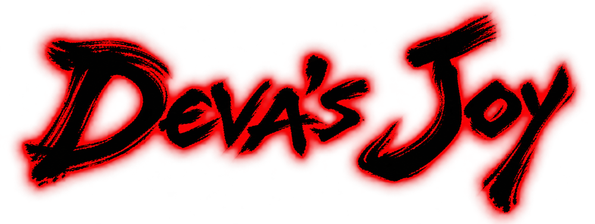

<p align="center">
  
</p>

<p align="center">
  <b>A native PC recompilation of <i>Asura's Wrath</i> (Xbox 360)</b><br>
  Static recompilation of the game's PowerPC code to x64, with a Direct3D 11 renderer and a Windows runtime.
</p>

---

> [!IMPORTANT]
> **Deva's Joy contains no game data.** You need your own copy of *Asura's Wrath* for Xbox 360 (the disc image and title update 1),
> plus any DLC you want to play. The setup program checks your files and unpacks them on your own PC.

> [!NOTE]
> This project is in **beta**. The game is playable, but expect rough edges: see [Known issues](#known-issues).

## Contents

- [What it is](#what-it-is)
- [Features](#features)
- [Requirements](#requirements)
- [The game files you need](#the-game-files-you-need)
- [Installing](#installing)
- [Playing](#playing)
- [Updating and adding DLC](#updating-and-adding-dlc)
- [Troubleshooting and reporting problems](#troubleshooting-and-reporting-problems)
- [Known issues](#known-issues)
- [Building from source](#building-from-source)
- [Project layout](#project-layout)
- [Credits and licences](#credits-and-licences)
- [Legal](#legal)

## What it is

*Asura's Wrath* (CyberConnect2 / Capcom, 2012) runs on Unreal Engine 3 and never came to PC. Deva's Joy translates the game's own Xbox 360
executable into C++ ahead of time with [XenonRecomp](https://github.com/hedge-dev/XenonRecomp), then compiles it into a normal Windows program.
A runtime written for this project stands in for the Xbox 360: its kernel and system calls, file system, controller input, XMA audio and the
Xenos GPU, which is translated to Direct3D 11 on the fly.

Because the game's code runs natively rather than through an emulator, it runs at full speed on modest hardware and can go beyond the
original: higher internal resolutions, 60 fps and modern display options.

## Features

- **Higher resolutions:** render at up to 4x the original 1280x720, independently of the output resolution.
- **60 fps** as well as the original 30.
- **Display options:** vsync (with a variable-refresh mode for G-Sync / FreeSync displays), windowed or full screen (Alt+Enter / F11),
  gamma, anti-aliasing (FXAA) and texture filtering (up to anisotropic).
- **Story Mode** (optional): invincibility and automatic QTEs, for playing *Asura's Wrath* as the interactive anime it is.
- **Button labels:** Xbox, PlayStation or Switch prompts (the PlayStation and Switch sets are built from the game's own icons and are not
  included in releases yet).
- **All DLC supported:** Episode Pack: Part IV (episodes 19-22, the game's true ending), Episodes 11.5 and 15.5, and Lost Episodes 1 and 2.
- **Setup program:** finds and verifies your game files, unpacks them, and lets you add DLC later.
- **Shaders compiled ahead of time** on the first start (behind a progress screen), and the rest in the background, so shader
  compilation rarely interrupts play.
- **Skip splash screens** option and an FPS counter.

## Requirements

| | |
|---|---|
| **OS** | Windows 10 or 11, 64-bit. "N" editions need the Media Feature Pack. |
| **CPU** | x64 with SSE4.1 (practically any CPU from 2008 on). More cores make the first-start shader compile faster. |
| **GPU** | Direct3D 11 (feature level 11.0) with a current driver. 11.1 is recommended. |
| **Controller** | An Xbox-compatible (XInput) controller. Keyboard and mouse are not supported yet. PlayStation and other controllers work through Steam Input or a similar tool. |
| **Disk** | About 6.2 GB for the game, 11 GB with all DLC, plus about 150 MB for the program. |
| **Install folder** | Somewhere you can write to (not Program Files), with a full path of at most 140 characters. Plain English letters in the path are safest. |

## The game files you need

You'll need to dump these yourself from your own console, disc and Xbox Live purchases. Setup identifies each file by its size and SHA-256,
so the file names don't matter.

| File | Needed | Usual name | Size (bytes) | SHA-256 |
|---|---|---|---|---|
| Disc image | **Required** | `Asura's Wrath (World).iso` | 8,738,846,720 | `b94db72ab0dcef88e14f47e820ef42502b3ebca246d50d564776e630287fd423` |
| Title update 1 | **Required** | `TU_11K620N_000000K000000.0000000000085` | 626,688 | `43914d513122c49afa70f051143f4b3b89279e5d9ef05f2ec73abc604c4dc0a0` |
| Episode Pack: Part IV | Strongly recommended | `78E95E38A274CA2033EB0517828152A3038C11C943` | 1,769,050,112 | `543e5273cf788cd9c5e47dcc3d629eb8a88f6996f6f46c2269bba800742be787` |
| Episode 11.5 | Optional | `8A6811EC2255FE171FAF9E4372B23B1B0581E4CA43` | 1,163,853,824 | `17c6b0f27d9c6d67c6693dd3712f3fb2d9bc2837d226c418302b3141b8c22ae2` |
| Episode 15.5 | Optional | `E2AFB00ED67E4B55C63F8DA33C0F8783F88E29B843` | 1,322,115,072 | `69c8d489c295086b755ac635a4c9279e394cb893a817e31cffd7580d00efff16` |
| Lost Episode 1 | Optional | `981ED33639F0A6275BA34BDD2E3D276C16F94A6D43` | 164,962,304 | `3a1315c5cbf102da29b9a55ff591be36cfebb2c64b5eade9b116b59eed24e089` |
| Lost Episode 2 | Optional | `F56F8734F04D89EAB07E9003A7F48DE046DA57B743` | 251,736,064 | `9fa7e282990404043b94d8f07ae53c8a6457474dd8a8becceb5e69f9d07d5a37` |

**Why the title update is required:** the update changes only one function in the game (it closes a leaked Xbox Live marketplace handle),
but every function after it moved in memory. The recompiled code was made from the updated executable, so it needs exactly that executable.
Details are in [NOTES.md](NOTES.md#what-the-title-update-changes).

**Why Part IV is strongly recommended:** episodes 19-22 follow episode 18 and carry the story to its real ending. Without them the game
stops short.

## Installing

1. Download the latest release zip and unpack it into a folder of its own, for example `C:\Games\AsurasWrath`.
2. Run **`asura_setup.exe`**. (Starting `asura.exe` before setup offers to open setup for you.)
3. Fill in your files: drop them on the setup window, use **Browse...**, or paste the paths. Setup also looks in the usual places on its own
   (its folder, Xenia's content folder, Downloads, Desktop and Documents), and **Search a folder...** looks wherever you point it.
   - **Green** means verified, or already installed.
   - **Red** means missing, or a different file (another version of the game or a damaged dump).
   - **OK** stays greyed out until the disc image and the title update are green.
4. Press **OK**. Setup unpacks the game and the DLC into the folder (a minute or so on an SSD), and offers to start the game.
5. On the first start the game reads its shaders from your game files and compiles them, with a progress screen. That takes a few minutes,
   once. Later starts go straight in. The first start after an update compiles once more.

> [!TIP]
> Windows may show **"Windows protected your PC"** the first time, because the programs aren't signed. Choose **More info**, then
> **Run anyway**.

## Playing

| | |
|---|---|
| **Options** | Back / View on the controller, or F1, on the title screen |
| **Full screen** | Alt+Enter or F11 |
| **Quit** | Close the window or press Alt+F4 (there's no Exit option in the game's menus) |

**Options menu**

| Row | What it does |
|---|---|
| Internal Resolution | Render scale: Auto, or 1x to 4x of 1280x720 (restart to apply) |
| Output Resolution | The size of the picture sent to the display |
| Frame Rate | 30 or 60 fps (restart to apply) |
| Vsync | Off, On, or On (FreeSync / G-Sync) for variable-refresh displays |
| Gamma | Brightness curve, 50-150% |
| Anti-aliasing | Off, FXAA or FXAA (high) |
| Texture Filtering | As the game sets it, bilinear, trilinear or anisotropic |
| Button Labels | Xbox, PlayStation or Switch prompts |
| Show FPS | A small frame-rate counter |
| Skip Splash Screens | Skips the logos at start |
| Story Mode | On, Off or Custom, with its two parts, **Invincibility** and **Automatic QTEs**, as their own rows |

Settings are saved to `asura.ini` in the game folder. Saves go to `saves\`.

## Updating and adding DLC

- **New version:** unpack the new release over the old folder. Your game data (`game\`, `private\`), saves and settings stay.
- **Adding DLC later:** run `asura_setup.exe` again. What's installed shows green; add the new DLC files and press OK.

> [!WARNING]
> Never share the `game\` or `private\` folders that setup creates: they hold the game itself.

## Troubleshooting and reporting problems

- **Crashes and errors:** if the game crashes or stops with an error, it saves a report in `logs\` (a text file and a small crash dump)
  and tells you where.
- **Logging:** start **`asura_debug.cmd`** instead of `asura.exe` to record a log in `logs\`.
- **Reporting:** include the version (it's in the window title), your Windows version, CPU, graphics card, controller, the episode and
  roughly where in it, what happened, and the files from `logs\`. Beta packages include `BETA_TESTING.txt` with a report template.

| Problem | What to try |
|---|---|
| A file stays red in setup | It's a different dump or version. Check its SHA-256 against [the table above](#the-game-files-you-need). |
| "This folder's path is too long" | Move the whole folder somewhere with a shorter path, e.g. `C:\Games\AsurasWrath`. |
| "Can't start its graphics" | The GPU or driver lacks Direct3D 11. Update the graphics driver. |
| No response to the controller | Only XInput controllers work directly. For other controllers, use Steam Input or a similar tool. |
| Controller chords switch away from the game | Deva's Joy blocks Alt+Tab, Escape and Windows-key presses that tools like Steam's controller layouts send while it's in front. If another tool still interferes, close it. |

## Known issues

- Keyboard and mouse aren't supported yet; a controller is required.
- PlayStation / Switch button prompts aren't included in releases yet (Xbox prompts are shown).
- Story Mode is still being finished: a few QTEs may still show or not be answered, and some meters behave differently. It can be
  switched off in Options.
- Now and then an object or its lighting appears a moment after a camera cut.
- Some shadow flicker in places (for example the mountain in an overhead city shot in episode 8, which Xenia shows too).
- Crowd voice lines can repeat or overlap, and music can be loud compared with voices in some scenes.

The full working notes, investigations and debug switches are in [NOTES.md](NOTES.md).

## Building from source

The repository holds the runtime, the tools and the recompilation config, but **not** the recompiled code (`ppc\`) or anything else made
from the game: you generate those from your own files. The scripts currently assume the repository is at `C:\dev\asura` and XenonRecomp at
`C:\dev\XenonRecomp`.

**Prerequisites**

- Windows 10/11 x64
- Visual Studio 2026 (18) with the C++ workload and its Clang tools (`clang-cl`); CMake 3.20+ and Ninja (both included with Visual Studio)
- [XenonRecomp](https://github.com/hedge-dev/XenonRecomp), built, with the additional instructions listed in
  [NOTES.md](NOTES.md#things-found) (vpkuhus, vpkuwus, vctuxs and others, not upstream yet)
- Python 3 (for the analysis tools in `tools\`) and a POSIX shell such as Git Bash (for `tools\patch_e0_alias.sh`)
- [FFmpeg](https://github.com/BtbN/FFmpeg-Builds/releases) 8.x, the `win64-lgpl-shared` build, unpacked into `thirdparty\ffmpeg`
  (its `bin\`, `include\` and `lib\` folders)

**Steps**

```powershell
# 1. Build setup alone (it doesn't need the recompiled code)
host\build.cmd --target asura_setup

# 2. Unpack your own game files into game\ and private\ (verifies them against the hashes above)
host\build\asura_setup.exe

# 3. Recompile the game's code into ppc\ from private\default.xex + default.xexp
cd config
C:\dev\XenonRecomp\out\XenonRecomp\XenonRecomp.exe asura.toml C:\dev\XenonRecomp\XenonUtils\ppc_context.h
cd ..

# 4. Apply the post-recompilation patch (the E0 memory window alias; see NOTES.md)
bash tools/patch_e0_alias.sh

# 5. Build everything: host\build\asura.exe and asura_setup.exe (about 2 minutes on 24 cores from clean)
host\build.cmd

# 6. Optional: a release package in release\ (refuses uncommitted changes; see the script header)
powershell -ExecutionPolicy Bypass -File tools\make_release.ps1 -Version 0.1.0-beta.1
```

During development `host\build\asura.exe` finds the game data in the repository folder (it looks for `game\disc` next to or above the exe).
`asura.exe --log` writes a log to `logs\`. The `ASURA_*` environment switches for debugging and testing are documented in
[NOTES.md](NOTES.md).

## Project layout

| Path | Contents |
|---|---|
| `host\` | The runtime: kernel and XAM imports (`kernel.cpp`, `xam.cpp`), file system (`kfile.cpp`), GPU command processor (`gpu.cpp`), the Direct3D 11 Xenos renderer (`xenos.cpp`), audio and XMA decoding (`audio*.cpp`, `xma.cpp`), the Options menu (`options.cpp`), game-specific hooks (`hooks.cpp`, `uescript.cpp`) and setup (`setup.cpp`) |
| `config\` | XenonRecomp configuration and the jump tables found by `tools\jumptables.py` |
| `tools\` | Game-file and executable tools (XDVDFS, STFS, XEX), recompilation analysis, the release script |
| `thirdparty\` | libmspack (LZX), the XEX patcher from XenonRecomp (`xexpatch\`); FFmpeg goes here too, outside git |
| `shader_manifest.txt` | The record of shaders the game uses (keys into your own game files, no game code), compiled on first start |
| `recomp_check\` | A compile check for the generated code |
| `NOTES.md` | Working notes: how everything was found and fixed, open issues, debug switches |
| `game\`, `private\`, `ppc\` | Made from your own files; never committed (see `.gitignore`) |

## Credits and licences

- [XenonRecomp](https://github.com/hedge-dev/XenonRecomp) (MIT) by hedge-dev and contributors: the static recompiler, and the XEX patcher
  in `thirdparty\xexpatch`, itself derived from [Xenia](https://github.com/xenia-project/xenia) (BSD).
- [Xenia](https://github.com/xenia-project/xenia), the Xbox 360 emulator: an invaluable reference for the hardware and the Xenos GPU.
- [libmspack](https://www.cabextract.org.uk/libmspack/) (LGPL 2.1): LZX decompression.
- [FFmpeg](https://ffmpeg.org/) (LGPL, shared libraries): XMA audio decoding.
- [tiny-AES-c](https://github.com/kokke/tiny-AES-c) (public domain) and TinySHA1: used by the XEX patcher.

Release packages include these licences in `licenses\`.

## Legal

Deva's Joy is a fan project. It is not affiliated with, authorised by or endorsed by Capcom, CyberConnect2 or Microsoft. *Asura's Wrath*
is a trademark of Capcom; Xbox and Xbox 360 are trademarks of Microsoft. No game assets are distributed with this project, and you must
own the game to use it. Please support the original creators.
